<!-- ─── HERO BANNER ─────────────────────────────────────────────────────────── -->
<div align="center">
  
</div>

<br/>

<!-- ─── ABOUT ME ──────────────────────────────────────────────────────────────── -->
##  &nbsp; About Me

<table>
<tr>
<td width="56%" valign="top">

```javascript
const salih = {
  role: "Computer Science Student",
  title: "Full Stack Web Developer",
  location: "Pakistan 🇵🇰",

  building: [
    "Portfolio v2 — Next.js 16 + Three.js + MongoDB",
    "Full-Stack Web Applications",
  ],

  learning: [
    "Next.js App Router Architecture",
    "TypeScript in Production",
    "AI Engineering & LLM APIs",
  ],

  tech: {
    frontend: ["React", "Next.js", "Tailwind", "Three.js"],
    backend:  ["Node.js", "Express.js", "REST APIs"],
    database: ["MongoDB", "Mongoose"],
    tools:    ["Git", "VS Code", "Cloudinary"],
  },

  goal: "Full Stack Developer → AI Engineer",
};
```

> *"Consistency beats intensity. Build one project at a time."*

</td>
<td width="44%" align="center" valign="middle">
  
</td>
</tr>
</table>

---

<!-- ─── CONNECT WITH ME ──────────────────────────────────────────────────────── -->
## 🔗 &nbsp; Connect With Me

<p align="center">
  <a href="https://www.linkedin.com/in/salih-hayat-dev/" target="_blank">
    
  </a>
  &nbsp;
  <a href="https://github.com/salih-x-tech" target="_blank">
    
  </a>
  &nbsp;
  <a href="mailto:salihhayat2241@gmail.com">
    
  </a>
</p>

---

<!-- ─── TECH STACK ────────────────────────────────────────────────────────────── -->
## 🛠 &nbsp; Tech Stack

<table>
<tr>
<td><strong>Languages</strong></td>
<td>
  
</td>
</tr>
<tr>
<td><strong>Frontend</strong></td>
<td>
  
  <br/>
  
  
  
</td>
</tr>
<tr>
<td><strong>Backend</strong></td>
<td>
  
  <br/>
  
  
  
  
</td>
</tr>
<tr>
<td><strong>Database</strong></td>
<td>
  
  <br/>
  
  
</td>
</tr>
<tr>
<td><strong>Tools &amp; Services</strong></td>
<td>
  
  <br/>
  
  
</td>
</tr>
</table>

---

<!-- ─── SKILLS STATUS ─────────────────────────────────────────────────────────── -->
## 📊 &nbsp; Skills Status

| Status | Technologies |
|:---:|:---|
| 🟢 **Used in Projects** | JavaScript (ES6+) · HTML5 · CSS3 · React.js · Node.js · Express.js · MongoDB · Mongoose · Tailwind CSS · Three.js · React Three Fiber · Bootstrap · EJS · Cloudinary · Git · GitHub |
| 🟡 **Actively Deepening** | TypeScript · Next.js App Router · Full-Stack Architecture · JWT Auth |
| 🔵 **Exploring** | AI Engineering · Generative AI APIs · LLM Web Integration |

---

<!-- ─── GITHUB ANALYTICS ──────────────────────────────────────────────────────── -->
## 📈 &nbsp; GitHub Analytics

<p align="center">
  
</p>

<p align="center">
  
  &nbsp;&nbsp;
  
</p>

<p align="center">
  
  &nbsp;&nbsp;
  
</p>

<p align="center">
  
</p>

---

<!-- ─── GITHUB TROPHIES ───────────────────────────────────────────────────────── -->
## 🏆 &nbsp; GitHub Trophies

<p align="center">
  
</p>

---

<!-- ─── FEATURED PROJECTS ─────────────────────────────────────────────────────── -->
## 📂 &nbsp; Featured Projects

---

### 🌐 [Portfolio v2](https://github.com/salih-x-tech/portfolio-v2) &mdash; Modern Full-Stack 3D Portfolio

A full-stack personal portfolio built with the latest Next.js App Router architecture, featuring a 3D interactive experience, secure admin dashboard, and dynamic project management system.

**Tech Stack:**
`Next.js 16` &nbsp; `React 19` &nbsp; `TypeScript` &nbsp; `Three.js` &nbsp; `React Three Fiber` &nbsp; `Tailwind CSS v4` &nbsp; `MongoDB` &nbsp; `Mongoose` &nbsp; `Cloudinary` &nbsp; `JWT`

**Features:**
- 🎮 Interactive 3D scene built with Three.js & React Three Fiber
- 🔐 Secure JWT-based admin panel for dynamic project management
- ☁️ Cloudinary media pipeline with image cropping & optimization
- 🗄️ Server-side REST API routes with MongoDB/Mongoose persistence
- 🖼️ Per-project case studies with screenshots, tech details & problem/solution write-ups

**Status:** 🔨 In Active Development

[](https://github.com/salih-x-tech/portfolio-v2)

---

### 🛍️ [LUXORA &mdash; Premium 3D E-Commerce](https://github.com/salih-x-tech/luxora-3d-ecommerce) &mdash; Interactive WebGL Store

A portfolio-quality 3D e-commerce site with interactive product visualization, glassmorphism dark UI, and persistent cart/wishlist management.

**Tech Stack:**
`React 19` &nbsp; `Three.js` &nbsp; `React Three Fiber` &nbsp; `@react-three/drei` &nbsp; `Tailwind CSS` &nbsp; `Framer Motion` &nbsp; `Zustand` &nbsp; `Vite`

**Features:**
- 🔮 3D product viewer with mouse-controlled rotation (OrbitControls)
- 🌙 Dark luxury glassmorphism design with light mode toggle
- 🔍 Real-time filtering by category, price range, and search
- 🛒 Persistent shopping cart & wishlist via Zustand state management

**Status:** ✅ Live

[](https://luxora-3d-ecommerce.vercel.app)
&nbsp;
[](https://github.com/salih-x-tech/luxora-3d-ecommerce)

---

### 🛒 [CodeAlpha E-Commerce Store](https://github.com/salih-x-tech/CodeAlpha_Ecommerce_Store) &mdash; Full-Stack MVC Application

A complete production-style e-commerce application built with Node.js MVC architecture, secure authentication, Cloudinary image uploads, and a full shopping flow.

**Tech Stack:**
`Node.js` &nbsp; `Express.js` &nbsp; `MongoDB` &nbsp; `Mongoose` &nbsp; `EJS` &nbsp; `Cloudinary` &nbsp; `Multer` &nbsp; `bcryptjs` &nbsp; `express-session` &nbsp; `Bootstrap`

**Features:**
- 🔒 Session-based auth with bcrypt password hashing
- 🛒 Full flow: browse → cart → wishlist → orders → reviews
- 📸 Admin dashboard with Cloudinary product image uploads
- ⭐ Product review and star rating system
- 👤 User profile management with editable settings

**Status:** ✅ Source Verified

[](https://github.com/salih-x-tech/CodeAlpha_Ecommerce_Store)

---

### 🌐 [SocialSphere](https://github.com/salih-x-tech/CodeAlpha_SocialSphere) &mdash; Full-Stack Social Media Platform

A complete social media platform with user accounts, image posts, likes, comments, and a follow/unfollow system — built with a classic Node.js + EJS MVC approach.

**Tech Stack:**
`Node.js` &nbsp; `Express.js` &nbsp; `MongoDB` &nbsp; `EJS` &nbsp; `Cloudinary` &nbsp; `Multer` &nbsp; `bcryptjs` &nbsp; `express-session`

**Features:**
- 👤 User registration, authentication, and profile management
- 📸 Image post creation with Cloudinary uploads
- ❤️ Like, comment, and follow/unfollow other users
- 📰 Dynamic home feed with posts from followed users

**Status:** ✅ Source Verified

[](https://github.com/salih-x-tech/CodeAlpha_SocialSphere)

---

### 🏢 [APEX Digital Agency](https://github.com/salih-x-tech/apex-digital-agency) &mdash; Interactive Agency Website

A production-grade digital agency website showcasing advanced CSS animations, interactive JavaScript components, and modern responsive design.

**Tech Stack:** `HTML5` &nbsp; `CSS3` &nbsp; `JavaScript (ES6+)`

**Features:**
- 🎴 3D hover tilt cards & scroll-reveal animations
- 🖼️ Portfolio filtering system & testimonials slider
- 💰 Monthly/annual pricing toggle
- 🖱️ Custom cursor effects & smooth scroll navigation

**Status:** ✅ Live

[](https://salih-x-tech.github.io/apex-digital-agency/)
&nbsp;
[](https://github.com/salih-x-tech/apex-digital-agency)

---

### 📞 [Call Cards App](https://github.com/salih-x-tech/call-cards-app) &mdash; Contact Management App

A clean, responsive contact manager built with vanilla JavaScript and Local Storage.

**Tech Stack:** `HTML5` &nbsp; `CSS3` &nbsp; `JavaScript` &nbsp; `Local Storage`

Create & delete contacts · Real-time search · Dark/Light theme · Local Storage persistence · Responsive design

[](https://salih-x-tech.github.io/call-cards-app/)
&nbsp;
[](https://github.com/salih-x-tech/call-cards-app)

---

<!-- ─── LEARNING ROADMAP ───────────────────────────────────────────────────────── -->
## 📚 &nbsp; Learning Journey & Roadmap

```
✅  HTML5 & CSS3                — Completed
✅  JavaScript Fundamentals     — Completed
✅  Git & GitHub                — Completed
✅  REST APIs & Fetch           — Completed
✅  Node.js & Express.js        — Completed (used in real projects)
✅  MongoDB & Mongoose          — Completed (used in real projects)
✅  React.js                    — Completed (used in real projects)
✅  Three.js / React Three Fiber — Completed (used in real projects)
🔄  TypeScript                  — Actively Learning
🔄  Next.js App Router          — Actively Learning
🔄  Full-Stack Architecture     — Actively Deepening
🔵  AI Engineering & LLMs      — Exploring
⏳  System Design               — Long-term Goal
```

---

<!-- ─── FOOTER ─────────────────────────────────────────────────────────────────── -->
<div align="center">

<br/>

### 💡 Philosophy

> *"Consistency beats intensity. Build one project at a time."*

<br/>


<br/>
<sub>⭐ If you found my work interesting, a star on any repo means a lot — thank you for visiting!</sub>

</div>
